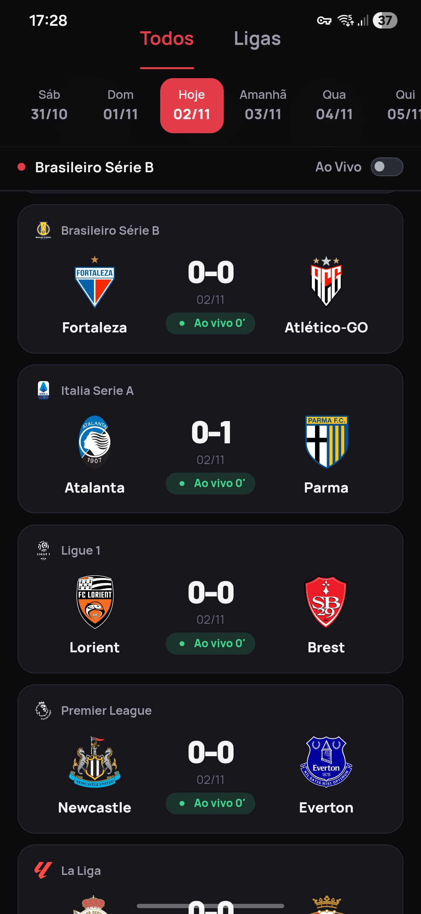
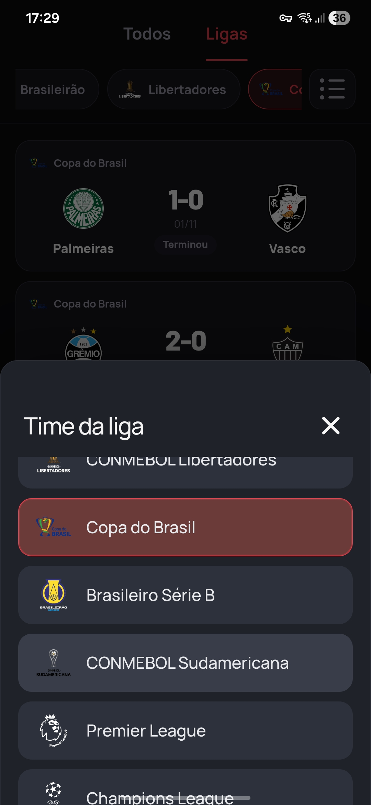
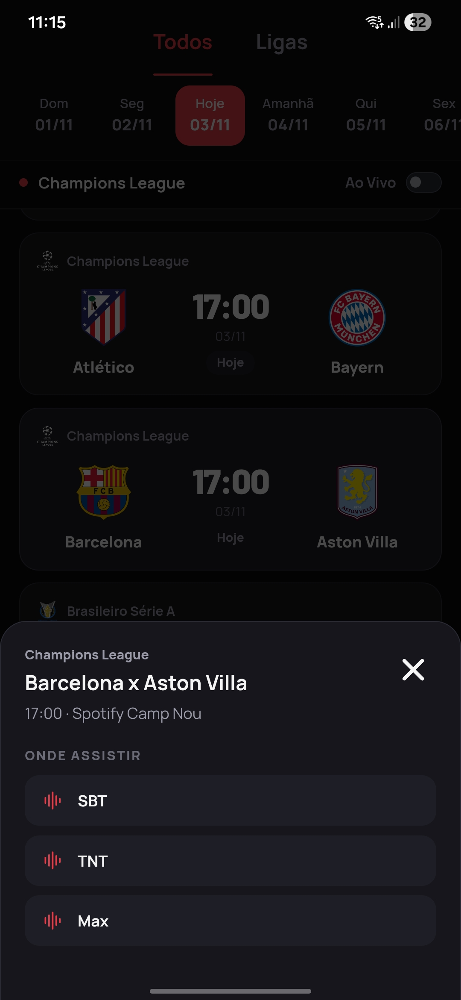

# Cardápio FC

Aplicativo Android para consultar partidas de futebol, horários, placares, competições e canais de transmissão em um único lugar.

[](https://github.com/Nekyl/CardapioFC/releases/latest)
[](https://github.com/Nekyl/CardapioFC/releases)

## Download

Baixe a versão mais recente diretamente na página de releases do GitHub:

**[Baixar a versão mais recente do Cardápio FC](https://github.com/Nekyl/CardapioFC/releases/latest)**

Cada release pode incluir duas variantes: a **ARM64**, menor e indicada para a maioria dos celulares Android atuais, e a **universal**, que também inclui `x86_64` para emuladores e dispositivos compatíveis.

O Cardápio FC possui uma interface nativa baseada em WebView e um backend Python embutido no próprio APK. Dessa forma, o usuário não precisa instalar Python, configurar um servidor local ou informar o IP de outro computador.

> O aplicativo é autocontido quanto ao código e ao backend, mas precisa de conexão com a internet para buscar os dados atualizados das partidas.

## Recursos

- Lista de jogos do dia e do dia seguinte.
- Navegação por datas.
- Filtro por ligas e competições.
- Exibição de jogos agendados, ao vivo e encerrados.
- Placar e status das partidas.
- Identificação de canais e serviços de transmissão quando disponíveis.
- Atualização de partidas ao vivo.
- Cache local para melhorar a experiência durante consultas repetidas.
- Interface responsiva para celulares Android.
- Compatibilidade com WebViews mais antigos, incluindo aparelhos como Galaxy S9.
- Backend Python executado dentro do APK, sem servidor externo do usuário.

## Screenshots

<div align="center">
  <table>
    <tr>
      <td align="center" valign="top">
        
        <br>
        <sub>Partidas ao vivo</sub>
      </td>
      <td align="center" valign="top">
        
        <br>
        <sub>Ligas e competições</sub>
      </td>
      <td align="center" valign="top">
        
        <br>
        <sub>Onde assistir</sub>
      </td>
    </tr>
  </table>
</div>


## Como funciona

A interface é formada por HTML, CSS e JavaScript carregados localmente no APK. A `MainActivity` usa o WebView para servir esses arquivos por um host local virtual e intercepta as chamadas para `/api/...`.

Quando o frontend solicita os jogos, a Activity chama funções do módulo Python embutido via Chaquopy. O `app.py` consulta as fontes externas, normaliza os dados e devolve o resultado para o JavaScript.

```text
WebView (HTML/CSS/JS)
        │
        │ /api/games
        ▼
MainActivity.java
        │
        │ Chaquopy
        ▼
Python embutido (app.py)
        │
        ├── ESPN Soccer API
        └── futebolnatv.com.br
```

## Tecnologias

- Java
- Android SDK 35
- Gradle e Android Gradle Plugin
- Chaquopy
- Python 3.12
- FastAPI
- Requests
- SQLite para cache local
- HTML, CSS e JavaScript sem framework frontend obrigatório

## Requisitos para compilar

- Android Studio recente ou Gradle 8.9.
- Android SDK 35.
- JDK 17 ou 21.
- Python 3.12 instalado no computador de build.
- Conexão com a internet no primeiro build para baixar o runtime Python e as dependências.

## Compilação

Clone o repositório e entre na pasta do projeto:

```bash
git clone https://github.com/Nekyl/CardapioFC.git
cd CardapioFC
```

Compile a release:

```bash
./gradlew :app:assembleRelease
```

O APK será gerado em:

```text
app/build/outputs/apk/release/app-release.apk
```

Por padrão, o build gera o APK compacto somente para `arm64-v8a`. Para gerar o APK universal, incluindo também `x86_64`, use:

```bash
./gradlew :app:assembleRelease -Puniversal
```

O código da aplicação é o mesmo nas duas variantes; somente as bibliotecas nativas Python incluídas no APK mudam. A variante universal é maior, mas também atende emuladores e dispositivos x86_64.

Sem uma configuração de assinatura local, o Gradle gera uma release não assinada. Para instalar diretamente em um aparelho, use uma keystore própria ou compile uma variante debug:

```bash
./gradlew :app:assembleDebug
```

## Assinatura da release

A keystore não faz parte do repositório público. Para assinar localmente, copie o arquivo de exemplo:

```bash
cp signing.properties.example signing.properties
```

Edite `signing.properties` com os dados da sua keystore e coloque o arquivo `.jks` no caminho indicado. Esses arquivos estão no `.gitignore` e não devem ser enviados ao GitHub.

Nunca publique a keystore nem as senhas de assinatura. A mesma keystore deve ser preservada para lançar atualizações compatíveis do aplicativo já instalado.

## Compatibilidade

A configuração pública atual gera apenas a arquitetura `arm64-v8a`, que atende à maioria dos aparelhos Android modernos, independentemente de o processador ser Snapdragon, MediaTek, Exynos, Kirin, Tensor ou Unisoc.

A versão atual não inclui bibliotecas para `armeabi-v7a`, `x86` ou `x86_64`. Para suportar aparelhos exclusivamente 32-bit ou emuladores x86, é necessário adicionar essas ABIs no `app/build.gradle`, aumentando o tamanho final do APK.

O projeto usa `minSdk 26`, equivalente ao Android 8.0.

## Estrutura do projeto

```text
app/
├── src/main/java/                  Activity Android e integração com Python
├── src/main/python/                app.py e módulo de acesso usado pelo Java
├── src/main/assets/static/         HTML, CSS e JavaScript do frontend
├── src/main/res/                   Ícone, tema e recursos Android
└── proguard-rules.pro              Regras de minificação da release
build.gradle                        Plugins e configuração raiz
settings.gradle                     Módulos e repositórios Gradle
signing.properties.example          Modelo de assinatura local
```

## Fontes de dados

Os dados são obtidos em tempo de execução a partir de APIs e páginas públicas de terceiros. A disponibilidade, o horário de atualização, os nomes dos canais e a cobertura das competições podem variar conforme essas fontes.

O projeto não garante que todas as partidas ou transmissões estarão disponíveis em todos os momentos.

## Privacidade

O aplicativo não precisa de uma conta para consultar os jogos. As requisições necessárias são feitas para as fontes externas configuradas no `app.py`. O cache local é armazenado no espaço privado do aplicativo.
